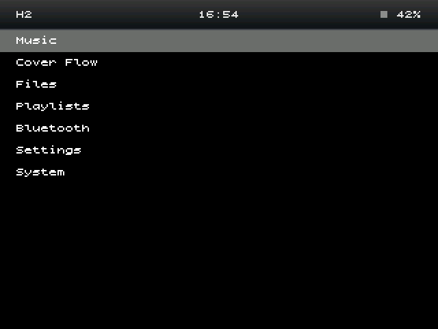
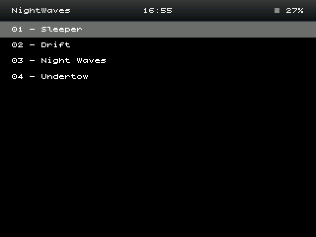
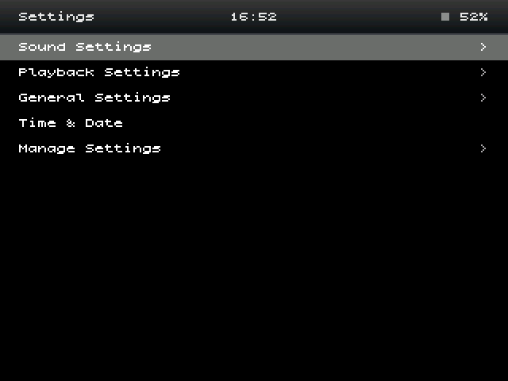
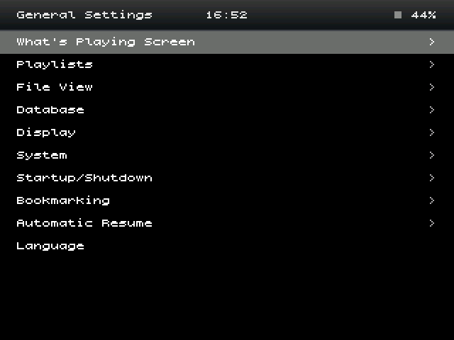

# Rockbox for the HiFi Walker H2

Rockbox for the **HiFi Walker H2** — the AIGO Eros Q native (Ingenic X1000,
MIPS, 320×240 16-bit LCD, 32 MB RAM, scroll wheel) — with a UI drawn by hand
in C, album covers throughout, and Bluetooth audio.

This repository is **[tiny5-rockbox](https://github.com/roman-kiselenko/tiny5-rockbox)**.
It is based on **[dismal-ad/h2-rockbox](https://github.com/dismal-ad/h2-rockbox)**,
the original HiFi Walker H2 port: that tree (forked from upstream
[Rockbox](https://www.rockbox.org/) at commit `212bb63ee4`) supplies the
`erosqnative` target, the Bluetooth port and the first version of the UI; this
repo carries the current work on top of it.

- The UI overhaul is **code-drawn** (`apps/newui/`): the skin/theme engine and
  WPS files are gone, and icons are glyphs of the UI font plus drawn shapes
  rather than bitmap icon sets.
- Bluetooth is **A2DP + AVRCP**, ported from Thiago Lugli's
  [h2-rockbox-bt](https://github.com/thiagoelg/h2-rockbox-bt), which builds on
  Skye's Bluedroid port. It works on hardware revision 4 (hw4).

## Download

Grab the archive from the [releases of this repo](https://github.com/roman-kiselenko/tiny5-rockbox/releases)
and unzip it to the root of the SD card — it contains the `.rockbox` folder.
Unzipping over an existing install keeps your settings and Bluetooth pairings
(`unzip -o rockbox.zip -d /path/to/sdcard`), because `.rockbox/config.cfg`,
`bt_config.conf` and `bt_devices.txt` are not in the archive.

Until a release is published here, either [build from source](#build-from-source)
or use the base project's **v1.1** archive
([rockbox-h2-v1.1.zip](https://github.com/dismal-ad/h2-rockbox/releases/tag/v1.1),
15 MB), which predates the Tiny5 Mono font and the System Status / Battery
Usage screens. The 15 MB is mostly fonts: the Noto Sans CJK faces (about 27 MB
on the card) plus Tiny5 Mono. The UI here uses Tiny5 Mono only, so the
`newui-*.fnt` files are dead weight — deleting them saves 27 MB and changes
nothing (see [fonts](#fonts-and-languages)).

The player must already have the **official Rockbox bootloader** for the Eros
Q native (install it with Rockbox Utility, or use a stock Rockbox build once).
This tree cannot build bootloaders.

## Screenshots

Captured headlessly by the simulator (320×240, shown at 2×) over a test
library, with scripted button presses.

<table>
  <tr>
    <td><br><em>Home</em></td>
    <td><br><em>Now Playing</em></td>
  </tr>
  <tr>
    <td><br><em>Paused</em></td>
    <td><br><em>Volume readout</em></td>
  </tr>
  <tr>
    <td><br><em>File browser</em></td>
    <td><br><em>Album tracks</em></td>
  </tr>
  <tr>
    <td><br><em>Settings</em></td>
    <td><br><em>A submenu</em></td>
  </tr>
  <tr>
    <td colspan="2"><br><em>System status (System › System Status)</em></td>
  </tr>
</table>

## The interface

Everything on screen is drawn by hand in C (`apps/newui/`): Home, Now Playing,
Cover Flow, the file and database browsers, playlists, the settings menus, the
System screens, the lock screen, pop-ups, the on-screen keyboard, the USB
screen, the status bar and the boot animation. It is a text-first layout in a
9 px monospace font: 16 px rows, a 22 px status bar, nothing but the covers as
graphics.

- **Home** is the root screen: Now Playing (or resume), Music (the tag
  database), Cover Flow, Files, Playlists, Bluetooth, Settings, System.
- **Cover Flow**: albums as covers in a row, the centre one facing you and the
  others turned towards it with a reflection, animated by the wheel. Centre
  opens the album; a song starts the album from it. Music keeps playing while
  you browse.
- **Album art in lists**: rows with covers are two lines (name plus artist or
  album). Covers are decoded once and kept as pre-scaled thumbnails in
  `.rockbox/newui/thumbs`, with a small RAM cache — JPEG decoding on the fly
  is too slow on the X1000.
- **Now Playing**: the track as text (title, artist, album, "3 of 12 · shuffle",
  codec + bitrate + sample rate), the cover in the corner, and one progress
  line at the bottom. Changing the volume shows a volume band in place of the
  progress for a moment. Press Centre twice (or hold it) to scrub with the
  wheel.
- **Scrolling**: the wheel speeds up as you spin it, and a large letter shows
  while fast-scrolling a list.
- **Looks**: Dark or Light theme (same layout), Classic or Minimal selection,
  six accent colours, and an optional status bar clock. The status bar shows
  the play state, clock, Bluetooth and the battery as a number (red under 20%,
  with a `+` while charging).

### Fonts and languages

On this repo the whole UI is **Tiny5 Mono** (9 px tall, SIL OFL 1.1) —
[Gissio/font_Tiny5Mono](https://github.com/Gissio/font_Tiny5Mono) — so a row
is 16 px and the readout screens fit the panel. It carries Latin, Greek,
Cyrillic and IPA, so Russian and other Cyrillic text display, using Rockbox's
normal language files and codepages. (The v1.1 build of the base repo still
draws everything in Noto Sans CJK, which was the UI font before the switch to
Tiny5.)

**CJK is not supported yet.** The Noto Sans CJK JP faces (14/18/20/22/40 px,
SIL OFL 1.1) from an earlier iteration of the UI are still in
`fonts/newui`, still installed on the card, and are the starting point for a
Chinese/Japanese/Korean build. `fonts/newui/mkfonts.sh` regenerates them from
Noto Sans CJK with `tools/convttf` (needs libfreetype-dev); the generated
`.fnt` files are committed, so a normal build does not need FreeType.

### Controls

| Key | Lists and menus | Now Playing |
|---|---|---|
| Wheel | Move the selection (faster the harder you spin) | Volume |
| Centre (PLAY) | Open the selection | Play/pause; a second press, or a hold, scrubs with the wheel |
| Prev / Next | One item | Previous / next track; held, seek |
| Back | Up one level; held, jump to Now Playing | Back to where you came from |
| Menu | The menu | The on-play menu |
| Vol+ / Vol− | Volume | Volume |
| Power | Locks the keys and turns the display off, from any screen; one press wakes it | the same |

## Bluetooth

- A2DP source with SBC, plus AVRCP: the headphone's play/pause, next and
  previous work.
- Bluedroid (the ESP-IDF Bluetooth stack) in `lib/bluedroid/`, driven over
  UART by the Broadcom BCM4343A1 in the player. It was trimmed to this
  configuration: 202k → 99k lines of stack code with identical object code.
- Settings: `bt_enabled` (off by default), `bt_high_quality` and
  `bt_volume_sync`; Bluetooth is reached from Home, not from the settings menu.
- Pairings are stored in `.rockbox/bt_devices.txt`. Only **hw4** is supported.
- Cost: firmware text +425 KB.

## Battery and power

- **System › View Battery Usage**: a chart of the battery level against hours
  since the last charge, logged in the background.
- Nothing is drawn while the screen is off.
- The LCD waits for the end of a frame on an interrupt instead of polling, so
  the CPU sleeps during animations.
- The Bluetooth controller sleeps between packets (Broadcom sleep mode,
  asserted only while sending).
- The DAC and headphone amp are switched off while playing over Bluetooth.
- A temporary debug switch for the CPU speed (1008 / 252 MHz) and CPU idle
  statistics are in the debug menu, for measuring the remaining work.

The reasoning, measurements and the remaining steps are in
[docs/newui/POWER.md](docs/newui/POWER.md).

## What this tree does not have

Deliberately removed, and kept out:

- Every other target, CPU, config, keymap and driver; bootloader code and tools; the manual.
- Preprocessor branches for hardware the H2 lacks (touchscreen, remote LCD,
  recording, FM radio, S/PDIF, line-in/mic, button lights, iPod accessory...).
- Plugins: no loader, no plugin menu entries (the 2 MiB plugin buffer is still
  used as scratch memory by core code).
- The theme (skin) engine, the quick screen, WPS files, backdrops, the skinned
  status bar and lists, bitmap fonts other than the UI font.
- Voice (spoken menus): `apps/talk.h` and `apps/voice_thread.h` are inline
  no-ops.
- Codecs for formats this player will not get: game music (SID, NSF, SPC,
  SAP/ASAP, AY, VTX, GBS, HES, SGC, VGM, KSS), MOD, RealMedia, ATRAC3, AC3,
  Musepack, TTA, WMA Voice, Speex, ADX. Kept: MP1/2/3, AAC/HE-AAC, ALAC, FLAC,
  Vorbis, Opus, WAV/W64/AIFF, APE, WavPack, WMA/WMA Pro, Shorten, DSD, AU, VOX,
  SMAF.

The core (apps, firmware, lib, simulator, excluding Bluedroid) is about 296k
lines of code, down from roughly 1.6M upstream.

## Build from source

Tested on Ubuntu. Full steps, including the simulator, are in
[docs/README](docs/README).

```bash
# tools needed to build
sudo apt install build-essential git perl zip unzip wget flex bison texinfo

# get the code
git clone https://github.com/roman-kiselenko/tiny5-rockbox.git
cd tiny5-rockbox

# build the MIPS cross-compiler once (takes a while), into ~/rockbox-toolchain
RBDEV_PREFIX=$HOME/rockbox-toolchain RBDEV_TARGET=i tools/rockboxdev.sh
export PATH=$HOME/rockbox-toolchain/bin:$PATH

# build the firmware, outside the source tree
mkdir build && cd build
../tools/configure --target=erosqnative --type=n
make -j$(nproc) && make zip
```

This gives `build/rockbox.zip`. Other build types still work: `--type=s`
(simulator, needs libsdl2-dev), `--type=w` (the warble codec test tool) and
`--type=a<opts>` for advanced builds (logf, debug, USB serial, small C library,
LTO). Profiling does not build on MIPS.

## Testing the UI in the simulator

The simulator runs the same code with the same screens, and can be driven from
a script: set `RB_SCRIPT` to a key script and `RB_SHOTDIR` to a directory, run
headless with `SDL_VIDEODRIVER=dummy SDL_AUDIODRIVER=dummy`, and it writes a
PNG per step. Commands are `wait`, `press`, `hold`, `wheel`, `usb`, `headset`,
`shot` and `quit` (see `uisimulator/common/sim_script.c`). Its virtual SD card
is `simdisk/` in the build directory — put test music there.

A change is considered good when the firmware, simulator and warble builds all
pass with no new warnings.

## Further reading

- [docs/newui/PLAN.md](docs/newui/PLAN.md) — the UI as designed and built:
  grid, colours, fonts, rows, motion, every screen, and how it differs from the
  original plan.
- [docs/newui/POWER.md](docs/newui/POWER.md) — the battery review and plan.
- [docs/README](docs/README) — build and install in detail.
- `tutorial.md` is a Rockbox plugin-writing guide kept for reference; this
  tree has no plugin loader.

## Credits and license

- Based on [dismal-ad/h2-rockbox](https://github.com/dismal-ad/h2-rockbox),
  which in turn is a cut-down fork of upstream
  [Rockbox](https://www.rockbox.org/) (commit `212bb63ee4`, 145 commits of
  history in this tree), reduced to a single configure target (`erosqnative`)
  and one binary for every hardware revision (the firmware reads the revision
  from the bootloader at runtime).
- Bluetooth from [thiagoelg/h2-rockbox-bt](https://github.com/thiagoelg/h2-rockbox-bt)
  (Thiago Lugli), built on Skye's Bluedroid port.
- Code under the GNU General Public License v2, like Rockbox. See
  [docs/COPYING](docs/COPYING). Tiny5 Mono
  ([Gissio/font_Tiny5Mono](https://github.com/Gissio/font_Tiny5Mono)) and Noto
  Sans CJK are under the SIL Open Font License 1.1 (`fonts/COPYING` and
  `fonts/newui/LICENSE-NotoSansCJK.txt`).
