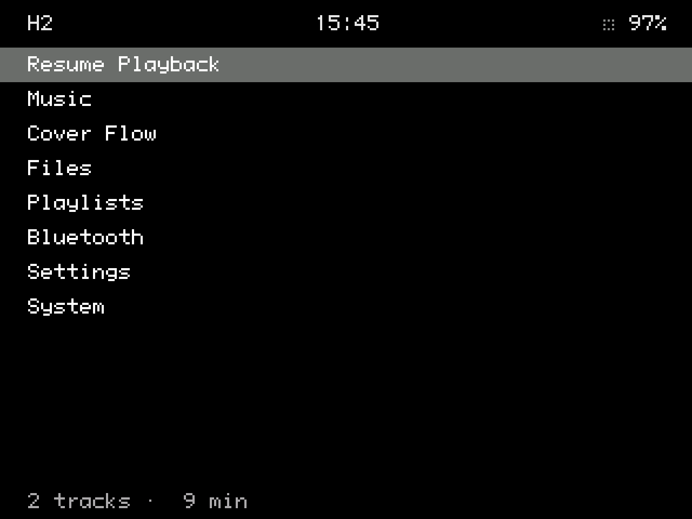
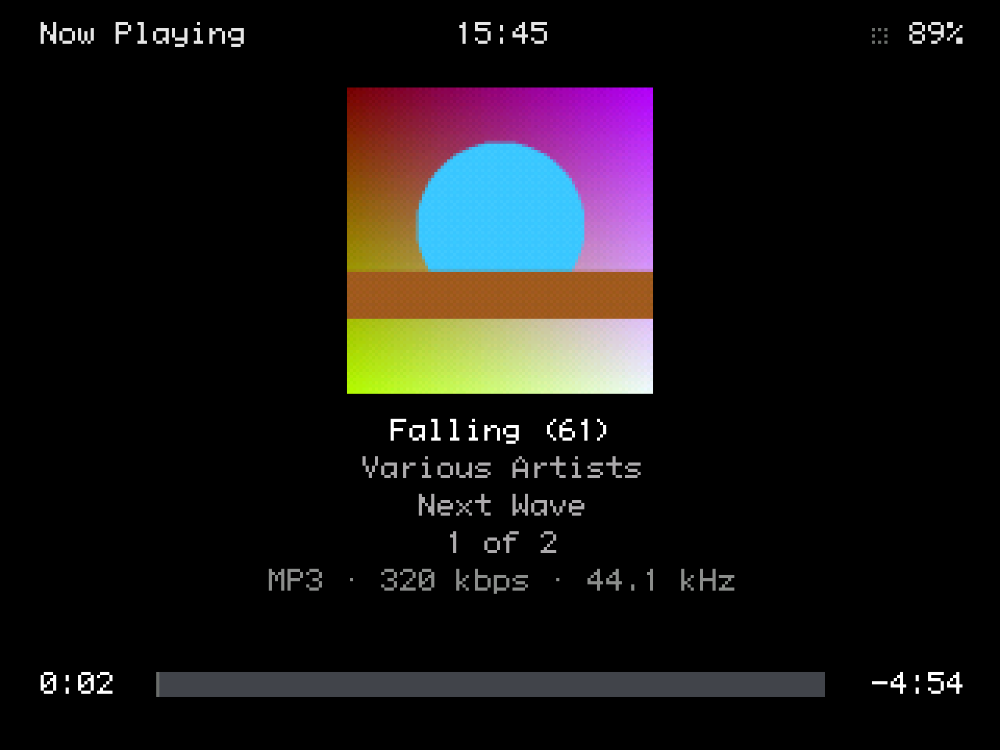

# Rockbox for the HiFi Walker H2

## Introduction

Rockbox for the **HiFi Walker H2** — the AIGO Eros Q native (Ingenic X1000,
MIPS, 320×240 16-bit LCD, 32 MB RAM, scroll wheel, no touchscreen) — with a UI
drawn by hand in C, album covers throughout, and Bluetooth audio.

This repository is **[tiny5-rockbox](https://github.com/roman-kiselenko/tiny5-rockbox)**,
built on **[dismal-ad/h2-rockbox](https://github.com/dismal-ad/h2-rockbox)**,
the original H2 port of [Rockbox](https://www.rockbox.org/): that tree (forked
upstream at commit `212bb63ee4`, 145 commits of history here) supplies the
`erosqnative` target, the Bluetooth port and the first version of the UI.

One firmware covers every hardware revision — it reads the revision from the
bootloader at runtime. Bluetooth is supported on revision 4 (hw4). The player
must already have the **official Rockbox bootloader** for the Eros Q native
(install it with Rockbox Utility, or run a stock Rockbox build once); this tree
cannot build bootloaders.

**Install.** Take the archive from the
[releases](https://github.com/roman-kiselenko/tiny5-rockbox/releases) and unzip
it to the root of the SD card — it contains the `.rockbox` folder. Unzipping
over an existing install (`unzip -o rockbox-h2-vX.Y.Z.zip -d /path/to/sdcard`)
keeps your settings and Bluetooth pairings, because `.rockbox/config.cfg`,
`bt_config.conf` and `bt_devices.txt` are not in the archive. The archive is
about 2.6 MB: firmware, codecs and the two UI fonts, Tiny5 Mono (452 KB) and
the Digital-7 numerals (208 B).

## Features

- **A UI drawn in C** (`apps/newui/`): Home, Now Playing, Cover Flow, the file
  and database browsers, playlists, the settings menus, the System screens, the
  lock screen, pop-ups, the on-screen keyboard, the status bar and the boot
  animation. Text-first, 9 px monospace, 16 px rows, a status bar in the page's
  own colour, drawn shapes instead of bitmap icons, and no rules or borders —
  bands are separated by colour only, like a terminal. The skin/theme engine and
  WPS files are gone. → [docs/INTERFACE.md](docs/INTERFACE.md)
- **Cover Flow and album art.** Covers in a row with the centre one facing you;
  art rows in every list. JPEGs are decoded once and kept as pre-scaled
  thumbnails in `.rockbox/newui/thumbs` with a small RAM cache, because
  decoding on the fly is too slow on the X1000.
- **Eight themes** — Dark, Light, Nord, Gotham, Rose Pine, Tokyo Night, One
  Light and GitHub Light — same layout, different palette; Classic or Minimal
  selection; the accent comes from the theme. Look settings live in
  Settings › General › Display.
- **Bluetooth audio.** A2DP source with SBC and AVRCP (headphone play/pause,
  next, previous), Bluedroid driven over UART by the Broadcom BCM4343A1.
  Reached from Home; `bt_enabled`, `bt_high_quality`, `bt_volume_sync`. →
  [docs/BLUETOOTH.md](docs/BLUETOOTH.md)
- **Power work.** Nothing is drawn while the screen is off, the LCD waits for
  the end of a frame on an interrupt instead of polling, the Bluetooth
  controller sleeps between packets, and the DAC and headphone amp are off when
  playing over Bluetooth. Battery use is logged and charted in
  System › View Battery Usage. → [docs/newui/POWER.md](docs/newui/POWER.md)
- **Cut down to one player.** No other targets, no plugins, no voice, no theme
  engine, no game-music codecs. The core is about 296k lines against roughly
  1.6M upstream. → [docs/CUT-DOWN.md](docs/CUT-DOWN.md)
- **Fonts.** Tiny5 Mono, with seven-segment **Digital-7** numerals for times
  and counts — the clock, the battery, track lengths. Latin, Greek, Cyrillic
  and IPA. CJK is deferred, not dropped — `fonts/newui/mkfonts.sh` is kept as
  the seed for a Chinese/Japanese/Korean build. → [docs/INTERFACE.md](docs/INTERFACE.md)

## Screenshots

Captured headlessly by the simulator over a test library with scripted button
presses — `ci/screens.script`, run by `ci/screens.sh` — 320×240 screens stored
at 2× (640×480), one folder per palette in
[docs/screens](docs/screens); how to make them is in
[docs/DEVELOPING.md](docs/DEVELOPING.md). Only the two screens that show the
design are kept, Home and Now Playing, in a dark palette and a light one; the
other six (Nord, Gotham, Rose Pine, Tokyo Night, One Light, GitHub Light) share
the layout.

| | Dark | Light |
|---|---|---|
| Home |  |  |
| Now Playing |  |  |

## References

What this project is built from:

- **[Rockbox](https://www.rockbox.org/)** — the upstream firmware, forked at
  commit `212bb63ee4`. Code under the GNU General Public License v2, as in
  [docs/COPYING](docs/COPYING).
- **[dismal-ad/h2-rockbox](https://github.com/dismal-ad/h2-rockbox)** — the
  original HiFi Walker H2 port: the `erosqnative` target, the drivers, the
  bootloader requirement and the first version of the UI.
- **[thiagoelg/h2-rockbox-bt](https://github.com/thiagoelg/h2-rockbox-bt)** —
  Thiago Lugli's Bluetooth manager, settings and menu, built on Skye's
  **Bluedroid** port (the ESP-IDF 6.0.1 Bluetooth stack, in `lib/bluedroid/`),
  trimmed to this configuration.
- **Broadcom BCM4343A1** — the player's Bluetooth chip, driven over UART (HCI
  H4) with its patchram firmware in `BCM4343A1_*.c`.
- **Tiny5 Mono** by [Gissio](https://github.com/Gissio/font_Tiny5Mono), SIL
  Open Font License 1.1 ([fonts/COPYING](fonts/COPYING)) — the UI font.
- **Digital-7 Mono** by Sizenko Alexander (Style-7, 2008) — the seven-segment
  numerals; freeware, see `fonts/newui/LICENSE-Digital7.txt`.
- **Noto Sans CJK** (SIL OFL 1.1, `fonts/newui/LICENSE-NotoSansCJK.txt`) — the
  deferred CJK faces, no longer installed.
- **Rockbox Utility** — the official way to put the Rockbox bootloader on the
  player.

Documentation:

| Where | What |
|---|---|
| [docs/README](docs/README) | build and install, step by step |
| [docs/DEVELOPING.md](docs/DEVELOPING.md) | build types, simulator testing, the commit gate, releases and CI |
| [docs/INTERFACE.md](docs/INTERFACE.md) | the screens, the controls, fonts and languages |
| [docs/newui/PLAN.md](docs/newui/PLAN.md) | the UI as designed and built: grid, colours, rows, motion, every screen |
| [docs/newui/POWER.md](docs/newui/POWER.md) | the battery review, measurements and what is left |
| [docs/BLUETOOTH.md](docs/BLUETOOTH.md) | Bluetooth: the stack, the driver, settings, cost |
| [docs/CUT-DOWN.md](docs/CUT-DOWN.md) | what was removed from upstream and why it stays out |
| [docs/UISIMULATOR](docs/UISIMULATOR) | upstream's simulator notes |
| [docs/RELEASE_NOTES.md](docs/RELEASE_NOTES.md) | the release notes — one file per tag in `docs/releases/` |
| [tutorial.md](tutorial.md) | a Rockbox API tutorial (drawing, drawmodes, buttons and tick timing, menus, file I/O, config files, battery/backlight/RTC, with a quick reference card). Written for iPod Video *plugins*, so it reads `rb->lcd_draw()` where this tree uses `lcd_draw()`; there is no plugin loader here, so nothing in it runs. Kept as a reference for API signatures and idioms when writing screen code. |
