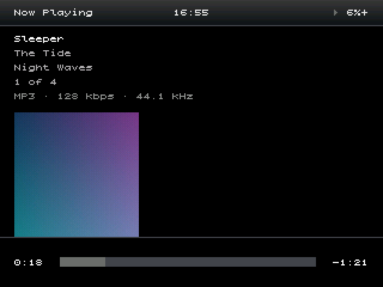
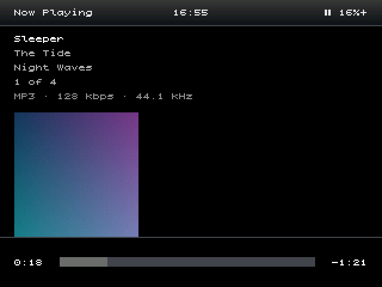
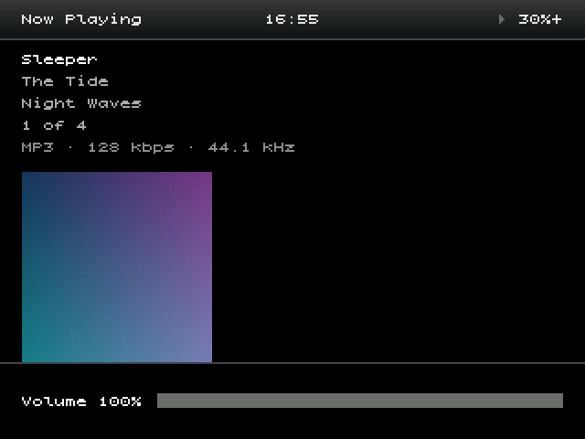
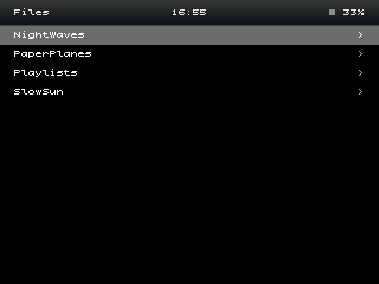
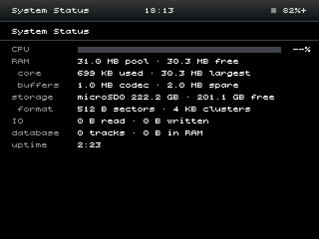

# Rockbox for the HiFi Walker H2

A Rockbox fork for the **HiFi Walker H2** (a rebrand of the AIGO Eros Q
native: Ingenic X1000, 320×240 screen, scroll wheel), with an iPod-style
interface drawn in code and Bluetooth audio.

Based on upstream [Rockbox](https://www.rockbox.org/) (forked from commit
`212bb63ee4`), stripped down to this one player.

## Screenshots

Captured headlessly by the simulator (320×240, shown at 2×) over a test
library, with scripted button presses.

<table>
  <tr>
    <td><br><em>Home</em></td>
    <td><br><em>Now Playing</em></td>
  </tr>
  <tr>
    <td><br><em>Paused</em></td>
    <td><br><em>Volume readout</em></td>
  </tr>
  <tr>
    <td><br><em>File browser</em></td>
    <td><br><em>Album tracks</em></td>
  </tr>
  <tr>
    <td><br><em>Settings</em></td>
    <td><br><em>A submenu</em></td>
  </tr>
  <tr>
    <td colspan="2"><br><em>System status (System › System Status)</em></td>
  </tr>
</table>

Everything is drawn in C with one font, Tiny5 Mono (9 px tall), so a row is
16 px and the readout screens fit the 320×240 panel.

## Features

### UI
- iPod-style look with a Dark and a Light theme, both sharing one layout.
- Cover Flow: iPod-style album browsing by cover.
- Slide transitions between screens.
- Faster scrolling with the wheel, and a large letter shown while
  fast-scrolling through a list.
- Redesigned splash, yes/no, USB, boot and shutdown screens.
- Boot animation, with a Skip Startup Animation setting.
- iPod-style Now Playing, with an iPod-style volume bar and a seek bar (press
  Centre twice).
- Power locks the keys and turns the display off, from any screen.

### Bluetooth
- Bluetooth audio, ported from Thiago Lugli's
  [h2-rockbox-bt](https://github.com/thiagoelg/h2-rockbox-bt), which builds on
  Skye's Bluedroid port.
- Unused Bluetooth stack code trimmed, from 202k to 99k lines.

### Battery and power
- Battery Usage page (System › View Battery Usage) with a chart of the level
  against hours since the last charge.
- Nothing is drawn while the screen is off.
- The CPU sleeps while it waits for the screen, instead of looping.
- The Bluetooth chip sleeps between packets.
- The DAC and headphone amp are switched off while playing over Bluetooth.
- A temporary debug switch for the CPU speed (1008 / 252 MHz).

### Code reduction
- Stripped to the H2 only.
- The tree went from about 1.6M code lines to about 295k before Bluetooth was
  added.

### Development tools
- The simulator can run scripted button presses and save PNG screenshots, for
  headless UI tests.

## Download and build

Tested on Ubuntu. Full steps, including the simulator, are in
[docs/README](docs/README).

```bash
# tools needed to build
sudo apt install build-essential git perl zip unzip wget flex bison texinfo

# get the code
git clone https://github.com/dismal-ad/h2-rockbox.git
cd h2-rockbox

# build the MIPS cross-compiler once (takes a while), into ~/rockbox-toolchain
RBDEV_PREFIX=$HOME/rockbox-toolchain RBDEV_TARGET=i tools/rockboxdev.sh
export PATH=$HOME/rockbox-toolchain/bin:$PATH

# build the firmware
mkdir build && cd build
../tools/configure --target=erosqnative --type=n
make -j$(nproc) && make zip
```

This gives `build/rockbox.zip`.

## Install

1. The player needs the official Rockbox bootloader for the Eros Q native
   (see the Rockbox manual or Rockbox Utility). This tree does not build
   bootloaders.
2. Unzip `rockbox.zip` to the root of the SD card. It contains the `.rockbox`
   folder. To update an existing install and keep your settings, unzip over it
   (`unzip -o rockbox.zip -d /path/to/sdcard`).
3. Eject the card and reboot the player.

Bluetooth works on hardware revision 4 (hw4) only.

## License

GNU General Public License v2, like Rockbox. See [docs/COPYING](docs/COPYING).
